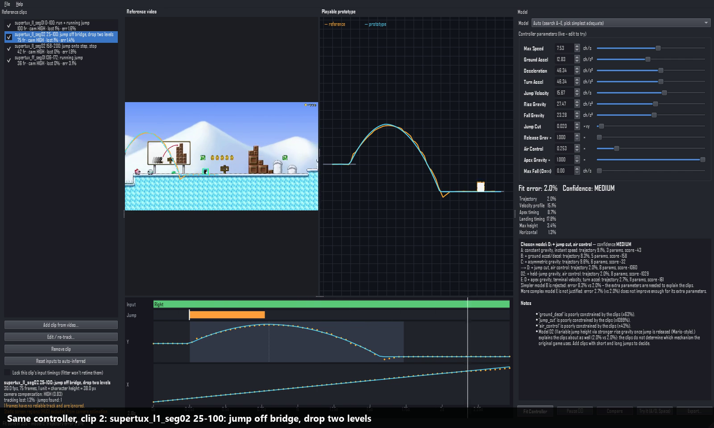

# Reference Controller Fitter

**Find the simplest playable 2D platformer controller whose movement matches reference gameplay footage.**

You give it short clips of a 2D platformer you like. It tracks the character, removes camera
scrolling, infers the button presses, and then searches for one small, readable controller
(max speed, acceleration, jump velocity, rise/fall gravity, jump cut, air control …) that
reproduces **all** clips at once. You see the reference video and the fitted prototype side by
side, play the prototype with the keyboard, tweak parameters live, and export a Unity C#
controller (or JSON / Godot GDScript).

It does **not** recover the original game's code. It finds a *behaviourally similar*
controller and tells you how well it matches, and which parameters the footage cannot pin down.



`docs/demo.mp4` is a recording of the real GUI: generic controller (40.6 % error), then Fit, then
about 2 % error, then keyboard play, then Unity export.

---

## Install

Requirements: Python 3.10+ (tested on 3.12, Windows 11). `ffmpeg` is only needed to render
the synthetic benchmark videos and the demo. The Unity checks need the .NET SDK and/or Unity.

```bash
python -m venv .venv
# Windows:  .venv\Scripts\activate      macOS/Linux:  source .venv/bin/activate
pip install -r requirements.txt
```

`requirements.txt` uses `opencv-contrib-python-headless` (CSRT/KCF trackers). Do not install
it together with another `opencv-python*` package in the same environment.

On Windows, keep the venv path short (or enable long paths). PySide6 contains very deep file
paths, and `pip` fails with `WinError 206` inside deeply nested folders.

## Run

```bash
python -m rcf                               # start the GUI
python -m rcf examples/supertux.rcf.json    # open a ready-made real-footage project
```

Example projects (File ▸ Open example):

| project | footage | result |
|---|---|---|
| `examples/synthetic.rcf.json` | 7 rendered clips of a known controller | model D, all params within 5 % of the truth |
| `examples/supertux.rcf.json` | SuperTux, 2 recordings by different people, 4 clips | model D, 1.4–3.1 % trajectory error per clip |
| `examples/smc.rcf.json` | Secret Maryo Chronicles, 15 fps recording, 2 clips | model B, 2.5–3.3 % |

The reference videos are in `references/real/`. Sources and licences are listed in
`references/real/SOURCES.md` (all Wikimedia Commons, GPL / CC BY-SA). Projects store video
paths relative to the project file.

## 5-minute workflow

1. **File ▸ Add clip from video…** Pick a gameplay video. In the dialog:
   * scrub to where the move starts and press **Set In**, then **Set Out**. Short clips (1–4 s)
     with one clear action work best;
   * drag a box around the character (or try **Auto-detect character**, then check it);
   * the default range is the first 5 s; changing In/Out after tracking discards the track.
     All lengths are measured in **character heights** (ch), so 1 ch = the tracked box height, one scale per video.
     You convert to your engine's units when you export;
   * press **Track**. The orange line is the tracked feet path, and red boxes are frames where tracking was lost.
     To fix them, scrub to a red frame, draw the right box, and press **Use box at this frame & re-track from here**;
   * camera compensation is on by default. If the dialog reports LOW confidence (for example
     because big parallax layers dominate), use **Draw camera background region** on the ground
     strip, or disable compensation for static-camera games.
2. Add more clips: standing jump, short tap jump, running jump, run → stop, turn, air steering.
   **The controller is fitted to all clips at once**, so variety helps.
3. Check the **timeline**. It shows the inferred inputs (Right/Left lane, Jump bars) and the
   reference (orange dots) against the prototype (cyan) for Y and X. Right-click to add or delete input
   events, and drag markers to retime them. Tick **Lock input timings** to stop the fitter adjusting them.
4. Press **Fit Controller**. With *Auto*, models A → E are fitted and the simplest adequate one is
   chosen. The error drops live while the prototype converges onto the reference.
5. Read the **model report**. It lists:
   * the error per metric;
   * the model comparison (why simpler models were rejected and why more complex ones are not justified);
   * the confidence, with reasons such as unconstrained parameters or clips the model cannot explain.
6. **Play** (synchronized playback, **Compare** overlays the prototype path on the video).
   Edit any parameter and the prototype and error update immediately.
7. **Try it (A/D, Space)**: play the fitted controller in a generated test level
   (steps, a wall, a floating platform, a gap). Hold Space for a long jump, tap it for a short jump.
8. **Export…** asks for *your character's height in engine units* and scales every length
   parameter accordingly. It writes:
   * `FittedPlatformerController.cs`, a complete Unity component;
   * `fitted_controller.json`;
   * or a Godot 4 script.

## Using the Unity controller

1. Copy `FittedPlatformerController.cs` into `Assets/`.
2. Create a GameObject with a **BoxCollider2D** and add the component. A Rigidbody2D is added
   automatically and set to *Kinematic*. Collisions are handled by the controller using `Rigidbody2D.Cast`.
3. Give the level geometry colliders on the layers selected in **Solid Layers**.
4. Optional: drag `fitted_controller.json` (as a TextAsset) into **Fitted Params Json** to
   override the baked-in values at Awake. All parameters are normal Inspector fields.
5. Input: A/D or arrow keys plus Space. This works with both the legacy Input Manager and the
   Input System package (`#if ENABLE_INPUT_SYSTEM`). For AI, replays or tests, set
   `useExternalInput` and call `SetInput(axis, jumpHeld)`.

The motion integrator inside the component is a line-by-line port of the fitter's model and splits
each step exactly where the acceleration changes, so behaviour does not depend on
`Time.fixedDeltaTime`.

The script has been verified in two ways:
* compiled against the UnityEngine assemblies of Unity 2022.3.51, 2022.3.62 and 6000.3.8, with 0 errors and 0 warnings;
* run inside Unity 2022.3.62 and 6000.3.8 in batch mode, with both input backends: a scripted
  run + long jump + short jump matches the Python model (x identical, y within 0.005 units, same apex).
  See `tools/unity_batch_check.py`.

## Tests

```bash
python -m pytest -q -m "not slow"     # 44 tests, ~1 min
python -m pytest -q                   # 45 tests incl. end-to-end synthetic benchmark from video (~3 min)
```

The suite covers:
* the integrator: analytic jump heights, step-size independence;
* the playable prototype;
* trajectory normalization;
* camera compensation, including parallax and drift;
* input and phase inference;
* the optimizer and multi-clip fitting;
* model selection: it picks B for model-B data and D for data that needs a variable jump, and reports low confidence when a clip can't be explained;
* serialization, Unity/Godot export and a real Unity-assembly compile (skipped without Unity + dotnet);
* a GUI smoke test (offscreen Qt);
* the full synthetic benchmark.

Developer tools:

| command | what it does |
|---|---|
| `python -m rcf.synthetic.render` | render the synthetic benchmark videos with a known controller |
| `python -m rcf.benchmark` | video → tracking → fit → compare with ground truth; writes `benchmark/synthetic_report.json` and `examples/synthetic.rcf.json` |
| `python examples/real_cases.py` | rebuild the SuperTux / SMC example projects from the footage |
| `python tools/eval_trackers.py` | compare template / CSRT / KCF / MIL / flow / hybrid trackers on the benchmark |
| `python tools/diagnose_clip.py VIDEO START END X Y W H out.png --fit D` | diagnostic plot for one clip |
| `python tools/unity_batch_check.py [controller.json]` | compile and run the exported controller inside installed Unity editors |
| `python -m rcf.export.compile_check FILE.cs` | compile against UnityEngine assemblies with `dotnet` |
| `python tools/godot_check.py GODOT_EXE [controller.json]` | run the exported GDScript headless in Godot 4 and compare with the model |
| `python tools/make_demo.py` | record `docs/demo.mp4` from the real GUI |

## Results (2026-10-06)

**Synthetic ground truth.** The controller is MaxSpeed 8, Accel 40, Decel 55, Jump 12, Rise g 38, Fall g 52, AirControl 0.55, JumpCut 0.45.
Seven rendered clips (camera follow with dead zone, parallax, HUD, squash-and-stretch sprite, H.264) were tracked and fitted. Results:
* model D is selected;
* every parameter is within 5 % of the truth (most within 2 %);
* behaviour error against the true controller under the true inputs is 0.05–0.44 %;
* on input sequences never seen during fitting it is 0.35–0.61 % (target ≤ 5 %).

**Real footage.**

| case | model | per-clip trajectory error (target ≤ 8 %) |
|---|---|---|
| SuperTux (4 clips, 2 recordings) | D, MEDIUM | 1.4, 1.6, 1.9, 3.1 % |
| Secret Maryo Chronicles (2 clips, 15 fps) | B, HIGH | 2.6, 3.3 % |

SuperTux is MEDIUM confidence for honest reasons, all listed in the report:
* D (velocity cut) and D2 (Mario-style gravity) fit equally well;
* the jump-cut factor is confounded with the unknown release time;
* deceleration is weakly constrained.

A clip from the speedrun that *looked* like a small hop turned out to be Tux running over a smooth
slope bump. The tool reported it as unexplained (landing timing 140 %), and it was removed:
slopes are out of scope.

See `KNOWN_LIMITATIONS.md` for what does not work, `ARCHITECTURE.md` for how it works,
`RESEARCH.md` for why, and `DEVLOG.md` for how it got there.

## License

The code is released under the [MIT License](LICENSE).

The reference gameplay videos in `references/real/` and the game footage shown in `docs/` are **not** covered
by the MIT License. They keep their original licences (GPL or CC BY-SA 3.0); authors, sources and licences
are listed in `references/real/SOURCES.md`.
